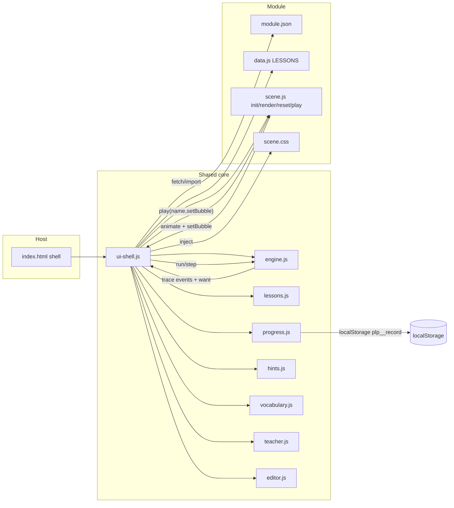
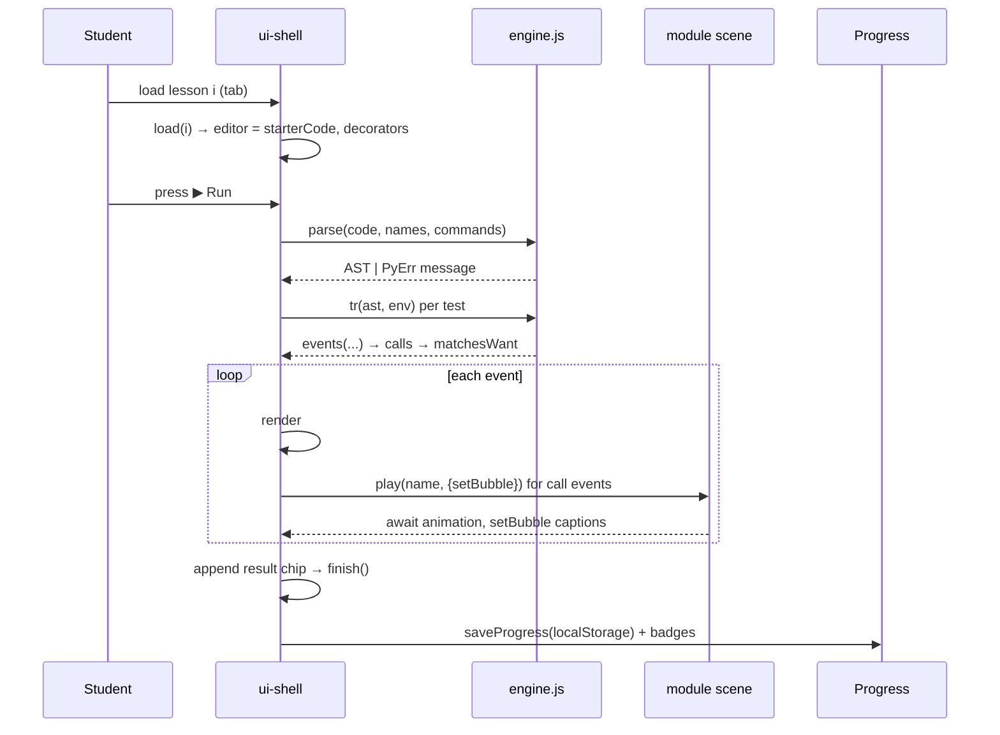

# Python Playground — Overall Architecture

> **Scope:** `main` branch of `github.com/eujinn/python_learning` — the shared scaffolding, complete engine v2, design system, and module template. Module branches (e.g. `module/l12_for_loop`) build on this base with lesson content only; they share `main`'s engine rather than forking it. See §9.

## 1. Overview

An **offline-capable static web platform** that teaches Python through interactive, visual lessons. No build step: plain HTML/CSS/JS with native ES modules, served from Netlify (or any static HTTP server; `file://` does not work because modules require HTTP).

Each lesson is rendered as a **split-screen workspace**:

- **Left pane (`section.card-panel` #1)** — mission header, Learn First guide, vocabulary pills, 3-tier hints, a Python code editor with line-number gutter and quick-insert syntax keys, Run/Next actions, result messages and student reflection.
- **Right pane (`section.card-panel` #2)** — a module-owned animated **scene** ("simulation") rendered by the module itself, a Python "thinking" **trace view** of the student's code, step-through controls, a variable pill row, and a test-result chip suite.

```
┌─────────────────────────────── shell (index.html) ───────────────────────────────┐
│ header: brand · module picker · Learning Record · Teacher Mode                   │
│ sub-header: progress pill (track + fill) · lesson tabs (1..N, last = 🎮 sandbox)  │
├─────────────────────────────── left card ───────────────┬───────────────────────┤
│ concept · mission title · mission story                 │  #module-scene          │
│ teacher drawer (hidden)                                 │  (module DOM: scene)    │
│ Learn First 6-step guide (collapsible)                  │  #legend                │
│ vocabulary pills · hints                                │  #view (trace)          │
│ editor (gutter + textarea) · syntax keys                │  #expl · #stepbar       │
│ ▶ Run / Next · #msg · reflection                        │  #vars · #res           │
└──────────────────────────────────────────────────────────┴───────────────────────┘
```

## 2. Repository layout

```
.
├── index.html              HTML shell (fixed element ids, no other markup)
├── modules.json            root manifest: ["_template"] on main
├── netlify.toml            publish ".", Node 20
├── AGENTS.md               contributor/agent contract (branch model, module contracts)
├── LICENSE, README.md, .gitignore
├── core/                   shared engine + UI (per-branch copies; drift allowed)
│   ├── engine.js           engine v2 adapter: parse() / tr() / py() (complete 20-lesson subset)
│   ├── lessons.js          adaptLesson() + label/exprOf/used/tallyCalls/matchesWant
│   ├── ui-shell.js         boot, module loader, tabs, step-through runner, event wiring
│   ├── editor.js           renderGutter(): line numbers for #code
│   ├── progress.js         per-module localStorage record, badges, Journey modal
│   ├── hints.js            3-tier hint state machine
│   ├── vocabulary.js       Learn First 6-question guide + vocab pills
│   └── teacher.js          offline SHA-256 auth + 5 classroom functions
├── css/                    shared design system (Argon-derived, light theme only)
│   ├── base.css            tokens (:root), reset, body gradient, .btn-3d
│   ├── layout.css          header, module select, tabs, progress pill, workspace grid
│   ├── editor.css          mission header, learn drawer, vocab, hints, editor shell, keys
│   ├── stage.css           scene shell, #bubble, #view trace, #stepbar, .vars/.pill, #res/.chip
│   └── modals.css          Journey/teacher modals, badges
└── modules/
    ├── _template/          canonical stub: module.json + data.js + scene.js + scene.css
    └── <id>/               one folder per module (created on module branches)
```

Shared `core/` and `css/` are **scaffolding**; module-specific rules live in the module's own `scene.css`, never in shared css files.

## 3. Boot sequence

```
index.html loads two module scripts
  └── core/editor.js   (registers gutter renderer helpers)
  └── core/ui-shell.js (everything else + boot)
        buildPicker()
          ├── fetch modules.json ─────────────────────────► ["_template", ...]
          │     per id: fetch modules/<id>/module.json → <option> in #modulePicker
          └── loadModule(firstId)
                ├── fetch module.json          (id, name, commands, labels, badges, css)
                ├── import data.js             → LESSONS[]
                ├── import scene.js            → { init, render, reset, play }
                ├── inject <link> scene.css    (module-local styles)
                ├── restore progress (localStorage plp_<id>_record)
                ├── sceneRoot.innerHTML = ""; api.init(sceneRoot)
                └── render #legend, #vars idle text; load(0)
                      load(i): fill title/task/starterCode, renderGutter(),
                               renderLearnFirst, resetHints, renderVocabulary,
                               api.render(base env) + api.reset(), tabs()
```

All DOM element ids are fixed and referenced by the `els` map in `ui-shell.js` — module authors must not rename shared ids; module-specific ids live inside the module's scene DOM.

## 4. The lesson data contract (`data.js`)

Each module exports `LESSONS`, an array of lesson documents (contract in `AGENTS.md`):

| field | purpose |
|---|---|
| `id`, `title`, `storyProblem`, `concept` | rendered mission header |
| `learnFirst` | 6-step guide: `problem, knownInfo, pythonQuestion, whyPath, action, learned` |
| `vocabulary` | `[{term, meaning}]` → tappable pills |
| `hints` | exactly 3 strings (concept clue / structure guide / guided correction) |
| `starterCode` | prefilled editor content |
| `solution` | canonical answer, must pass every `tests` entry |
| `variables` | names allowed in conditions (sensors) |
| `base` | default environment merged under every test |
| `tests` | `[{environment, want, label}]` — see `matchesWant` below |
| `teacherExplanation`, `commonMistakes[]`, `studentReflection` | teacher mode + reflection banner |
| `free` | optional `true` on the final sandbox lesson (🎮 tab) |

`core/lessons.js::adaptLesson()` flattens this rich schema into the compact runtime shape: `{ t, task, ex, names, base, free, start, sc }` where `sc` = tests merged with `want`/`label`.

## 5. The interpreter (`core/engine.js` on main — complete 20-lesson subset)

`main` carries a **full-capability pedagogical Python subset engine** (Engine v2) able to execute every construct across all 20 curriculum lessons. Individual modules restrict which syntax students may use by declaring `allowedSyntax` in `module.json` — the engine gates itself at parse time, not at capability level.

### 5.1 Engine file layout

```
core/
├── engine.js           ← integration adapter: parse() / tr() / py() wrappers (stable API for ui-shell)
└── engine/
    ├── lexer.js        ← tokenizer: source → tokens (handles indent/dedent, string escapes, comments)
    ├── parser.js       ← recursive-descent AST builder for all 35 constructs
    └── evaluator.js    ← tree-walk step tracer + syntax gate enforcement
```

### 5.2 What the engine supports (the complete unified scope)

| Category | Constructs |
|:---|---|
| **Literals & Types** | `int`, `float`, `str` (single/double quotes + escapes), `bool` (`True`, `False`), `None`, `list` (`[a, b]`) |
| **Variables** | `x = expr`, `+=`, `-=`, list indexing `items[i]`, `items[i] = val`, `items.append(val)` |
| **Arithmetic** | `+` `-` `*` (including `"ha" * 3`) `/` `//` `%`, unary `-`, parentheses |
| **Comparisons** | `==` `!=` `<` `>` `<=` `>=` `in` `not in`, chained (`3 < x < 10`, Python semantics) |
| **Booleans** | `and` `or` `not` (short-circuit, Python truthiness: `bool([])===false`, `bool("")===false`) |
| **Control flow** | `if` / `elif` / `else`, `for x in range(n)`, `for x in range(a,b,step)`, `for item in list`, `while cond:`, `break`, `continue` |
| **Built-in functions** | `print(*args)`, `len()`, `type()` (returns `"int"`, `"float"`, `"str"`, `"bool"`, `"list"`), `int()`, `float()`, `str()`, `abs()`, `min()`, `max()`, `input(prompt)`, `time.sleep(sec)` |
| **User-defined functions** | `def fn(params):`, `return expr`, call with args, recursion guard |
| **Comments** | `#` to end of line |

### 5.3 Syntax gates (`allowedSyntax`)

Each module's `module.json` declares which constructs are enabled:

```json
// module/l12_for_loop/module.json
{
  "id": "l12_for_loop",
  "allowedSyntax": ["print", "strings", "variables", "comparisons", "booleans", "for_range", "sleep"]
}
```

The gate list (every gate maps to one or more parser rules):

| Gate | Enables |
|:---|---|
| `"print"` | `print()` function calls |
| `"strings"` | `"..."` / `'...'` string literals |
| `"variables"` | `x = value`, variable reads in expressions |
| `"int"` / `"float"` | Numeric literals |
| `"type_cast"` | `int()`, `float()`, `str()` |
| `"type_query"` | `type()` |
| `"arithmetic"` | `+` `-` `*` `/` `//` `%`, string repetition |
| `"comparisons"` | `==` `!=` `<` `>` `<=` `>=` |
| `"booleans"` | `and` `or` `not` |
| `"if"` | `if` / `elif` / `else` |
| `"for_range"` | `for x in range(...)` |
| `"for_list"` | `for x in list` |
| `"while"` | `while cond:` |
| `"lists"` | `[...]`, `len()`, `.append()`, index |
| `"input"` | `input(prompt)` |
| `"sleep"` | `time.sleep(sec)` |
| `"def"` | `def fn():`, `return` |
| `"min_max_abs"` | `min()`, `max()`, `abs()` |

When a student types a construct not in the enabled gates, the parser emits a friendly `PyErr`: *"Hold on! `while` loops unlock in Lesson 16. Use `for` for this mission!"*

### 5.4 Pipeline: source → tokens → AST → trace events

```
source text
  └── lexer.js::tokenize(src)
        • normalises smart quotes/tabs
        • strips blank lines & # comments
        • emits INDENT/DEDENT tokens (4-space rule)
        • returns: [{type: "IDENT", value: "print", line: 1}, ...]
  └── parser.js::parse(tokens, names, allowedCalls, syntaxGates)
        • recursive-descent: program → statement* → if|while|for|set|call|def...
        • validates identifiers against `names` + allowedSyntax
        • returns AST: {t:"program", stmts:[...]}
  └── evaluator.js::evaluate(ast, env, events, context)
        • tree-walk tracer, mutates env in place
        • appends step events to events[]
        • enforces MAX_TRACE_STEPS=500, MAX_CALL_DEPTH=16
        • call  → { k:"call", n, f, args }
        • set   → { k:"set", n, key, val, env:copy }
        • cond  → { k:"cond", n, s, r, env:copy }
        • else  → { k:"else", n }
        • for   → { k:"for", n, var, val, iter, total, env:copy }
        • sleep → { k:"sleep", n, sec }
```

### 5.5 Integration adapter (`core/engine.js`)

`core/engine.js` re-exports the same public API so existing callers (`ui-shell.js`, `lessons.js`) work unchanged:

```js
// core/engine.js — adapter (stable API)
import { tokenize } from "./engine/lexer.js";
import { parse as parseAST } from "./engine/parser.js";
import { evaluate } from "./engine/evaluator.js";

export function parse(src, names, commands) { ... }
export function tr(ast, env, ev) { evaluate(ast, env, ev, { maxSteps: 500 }); }
export function py(val) { /* format runtime value → display string */ }
export class PyErr extends Error { /* kid-friendly error */ }
```

### 5.6 Safety mechanisms

- **Zero `eval` / `new Function()`** — CSP-safe, no JavaScript semantics leak into Python mental models
- **`MAX_TRACE_STEPS = 500`** — `while True:` halts cleanly with a loop-debugging hint instead of hanging the browser
- **`MAX_CALL_DEPTH = 16`** — prevents recursion overflow from beginner `def` misuse
- **`MAX_OUTPUT_LINES = 100`** — caps `print()` output
- **Syntax gates** — students cannot use constructs not yet taught

### 5.7 Error messages (`PyErr`)

All engine errors throw `PyErr` (line-numbered, kid-oriented messages):

| Mistake | Message |
|:---|---|
| Missing `()` | `"Line 3: Did you forget brackets? Try go()"` |
| Single `=` in condition | `"Line 2: Use two equals == to check if things match"` |
| Unknown call name | `"Line 1: I don't know the spell 'prnt' — did you mean print?"` |
| Unquoted string | `"Line 4: Words need quotes: \"hello\""` |
| Missing `:` | `"Line 2: Don't forget the colon : after if"` |
| Bad indent | `"Line 5: Python needs 4 spaces to start a block"` |
| Gated construct | `"Hold on! 'while' loops unlock in Lesson 16."`

## 6. The step-through runner (`core/ui-shell.js`)

1. `run()` parses the editor content; for each test scenario (or a single `{}` in free mode) it runs `tr()` against a fresh env, collecting events.
2. Commands are tallied from call events; `got` = last called command. Pass/fail uses `matchesWant(want, calls)`.
3. The trace view `#view` renders the source lines; `#stepbar` drives `step()`:
   - each event type gets a caption in `#expl` + `#bubble` (e.g. `cond` → "Is light == "red"? (light is …)"), with a ~900 ms pause;
   - `call` events invoke the module's async `play(f, { setBubble })` for animation;
   - on test end, a result `chip` is appended to `#res` (`✅ label → print()` or `❌ …` with "needed …").
4. `finish()` unlocks the next lesson, saves progress, updates header/badges, and shows the student-reflection banner.

`matchesWant` semantics (`core/lessons.js`):

| want | meaning |
|---|---|
| `"go"` | last called command is `go` |
| `"go*3"` | `go` called exactly 3 times |
| `"go+"` | `go` called at least once |
| `null` | free play, always passes |

## 7. Module scene API + design system

Every module folder ships four files:

- **`module.json`** — metadata contract: matching `id`/folder name, `name`, `icon`, `description`, `commands` (the *only* callable spell names), `labels` (trace captions), `legend` HTML, `idleText` for `#vars`, `css` path, `allowedSyntax` (syntax gates enabled for this lesson), `badges[]` (`levels` are 0-based lesson indices that must all be completed).
- **`data.js`** — `export const LESSONS` (§4).
- **`scene.js`** — the right-pane visual, implementing:
  ```js
  export function init(container)          // build scene DOM once; may include <div id="bubble">
  export function render(env)              // sync visuals to environment; on load + every assignment
  export function reset()                  // clear animations between tests
  export async function play(cmd, args, ctx)  // animate one command; cmd=name, args=[], ctx={setBubble}
  ```
- **`scene.css`** — module-local styling only (reuse design tokens).

The scene is the only interactive surface owned by the module — the engine drives it via `play()`, and it drives `render(env)` whenever sensor values change.

**Design system** (`css/base.css`, Argon-pro-derived, light arcade theme, no dark mode): tokens for app/card/subtle backgrounds, ink colors, borders, accents (`--primary`, `--success`, `--warning`, `--danger`, `--purple`), code theme, and back-compat scene tokens `--sky1/--sky2/--grass/--road/--sun`. Tactile `.btn-3d` buttons, `.workspace-grid`/`.card-panel` layout, `.level-tab` states, `.learn-drawer`, `.vocab-pill`, `.editor-shell`, `.syntax-keys`, `.badge-chip`, modals. Fonts: Fredoka for UI text, JetBrains Mono for code/pills/trace/gutter.

## 8. Supporting subsystems

| module | responsibility |
|---|---|
| `editor.js` | `renderGutter()` — syncs `.editor-gutter` line numbers to `textarea#code`; called on `input` and after programmatic editor changes. |
| `hints.js` | 3-tier state machine: concept clue → structure guide (code block) → guided correction (+ `commonMistakes` warning). |
| `vocabulary.js` | Renders Learn First 6-question guide and tappable vocab pills with popup. |
| `progress.js` | Per-module record in `localStorage` key `plp_<moduleId>_record` → `{completed[], earnedBadges[], updatedAt}`; drives header pill, Journey/learning-record modal, badge grid, next-skill banner. |
| `teacher.js` | Offline-auth via a pure-JS SHA-256 implementation compared to a stored passcode hash; 5 functions: reveal solution (load into editor), teaching notes, demonstrate step execution, expected test results table, reset student view. |

## 9. Branch model & module authoring (extensible engine)

### 9.1 Branch architecture

- **`main`** = shared scaffolding + `_template` + **complete Engine v2** (§5). Contains no module content — only `modules/_template/` as a reference.
- **`module/<id>`** branches (e.g. `module/l12_for_loop`) are created from `main` and carry only **content files**:
  ```
  modules/<id>/
    module.json      ← declares id, allowedSyntax, commands, labels, badges, etc.
    data.js          ← LESSONS array (story, learnFirst, hints, starterCode, tests)
    scene.js         ← scene lifecycle: init / render / reset / play
    scene.css        ← scoped stage styles
    modules.json     ← lists only this module's id
  ```
- **Engine is NOT forked.** Module branches use `main`'s `core/engine.js` directly — they never carry their own copy. Fixes to the engine on `main` propagate to all module branches on next `git rebase main`.
- **Scenes stay per-module.** Each branch has its own `scene.js`/`scene.css` — the engine, UI shell, and design system are shared.

### 9.2 Creating a new module

```
git checkout main -b module/l16_while_loop
cp -r modules/_template/ modules/l16_while_loop/
# Edit modules/l16_while_loop/module.json:
#   - set id, name, icon, allowedSyntax: ["variables", "comparisons", "booleans", "while"]
#   - set commands, labels, badges
# Edit modules/l16_while_loop/data.js — lesson content
# Edit modules/l16_while_loop/scene.js — visual stage
# Edit modules/l16_while_loop/scene.css — stage styles
# Register "l16_while_loop" in modules.json
```

**Zero engine work.** The engine on `main` already supports `while`. The module just enables it via `allowedSyntax`.

### 9.3 How module branches stay in sync with `main`

```
git checkout module/l16_while_loop
git rebase main
# Conflict risk: near zero — module branch only touches modules/<id>/*,
# never core/*. Engine fixes on main merge cleanly.
```

### 9.4 Deployment

Each `module/<id>` branch deploys to its own Netlify site (isolated per-lesson URLs for classroom focus). `modules.json` on the branch lists only the one module, so the student only ever sees their current lesson in the module picker.

## 10. Data-flow summary





## 11. Verification & deploy

- `node --check` all module/core JS; serve with `npx serve .` to confirm the module loads with no console errors.
- Run `node scripts/verify-all.mjs` (when available) to validate: schema completeness, every `solution` passes every `tests` entry, and non-observe `starterCode` fails at least one check.
- Each `module/<id>` branch deploys to its own Netlify site (isolated per-lesson URLs, one module per site via `modules.json`).
- `netlify.toml` publishes `.` with Node 20; ES modules require HTTP.